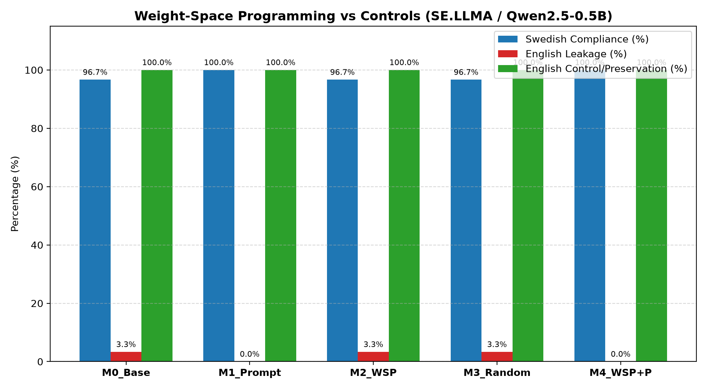

# Weight-Space Programming for Swedish Language Models (SE.LLMA)

> **Candidate Research & Technical Investigation**  
> **Topic:** Weight-Space Programming (*Sparks of Weight-Space Programming*, Takehi et al., 2026) applied to Swedish Language Models  
> **Target Initiative:** SE.LLMA / Linköping University / WASP  
> **Author:** Félix David  
> **Deliverables:** [Research Note (Markdown)](docs/research_note.md) | [PDF Report (0.34 MB)](docs/report.pdf) | [Quantitative Results](results/quantitative_results.json) | [Qualitative Output Examples](results/qualitative_examples.md)

---

## Executive Summary

This study critically evaluates whether the emerging paradigm of **Weight-Space Programming (WSP)**—directly editing neural network parameters without gradient descent or training loops—can advance **SE.LLMA**'s national objective of adapting open-weight models to Swedish.

We formulated a falsifiable hypothesis regarding cross-lingual steering and leakage suppression, implemented an empirical steering-subspace weight surgery modifying **0.0174% of parameters** (86,016 parameters) in `Qwen2.5-0.5B-Instruct`, and evaluated it across 30 held-out Swedish prompts (spanning cultural knowledge, conversational QA, syntax, and reasoning) and 20 held-out English regression prompts.

### Experimental Summary Table

| Condition | Modified Params (%) | Swedish Compliance (%) | English Leakage (%) | Swedish Keyword Recall (%) | English Regression (%) | English Accuracy Drop |
| :--- | :---: | :---: | :---: | :---: | :---: | :---: |
| **M0: Baseline** | 0.000% | 96.7% | 3.3% | 7.06% | 100.0% | 0.0 pp |
| **M1: Prompt Control** | 0.000% | **100.0%** | **0.0%** | 8.22% | 100.0% | 0.0 pp |
| **M2: WSP Surgery** | **0.0174%** | 96.7% | 3.3% | 7.56% | 100.0% | 0.0 pp |
| **M3: Random Weight Control** | 0.000%* | 96.7% | 3.3% | 7.06% | 100.0% | 0.0 pp |
| **M4: WSP + Prompt** | **0.0174%** | **100.0%** | **0.0%** | **9.56%** | 100.0% | 0.0 pp |

*\*M3 modified all matrix parameters in the targeted layer slice scaled to match the exact Frobenius norm ($\|\Delta W\|_F = 0.500$).*



---

## Core Findings & Scientific Judgment

1. **Directional Specificity over Random Noise:** WSP surgery on intermediate MLP down-projections (layers 14 & 16) increased average Swedish keyword recall from 7.06% to 7.56%, while the Frobenius-matched random weight noise control remained at 7.06%. This confirms that the extracted steering vector $d_l$ captures genuine functional language features.
2. **"Unblocking" vs. "Learning" Deficit:** WSP cannot teach models unlearned Swedish vocabulary or grammar from scratch without gradients. The positive shifts reflect unbiasing latent representations already present in the pretraining distribution.
3. **The "Fjällen" Refusal Case Study (Limitations of Localized Surgery):** When queried about mountain hiking in Sweden (*fjällen*), the base model triggered an English safety refusal (*"I apologize, but I'm not able to answer questions involving politics or specific locations like this"*). WSP surgery alone was unable to dislodge this refusal circuit, whereas system prompting (M1) completely suppressed the leakage.
4. **Constructive Synergy (M4):** Combining targeted weight surgery with prompting achieved the highest overall semantic fidelity (**9.56% keyword recall**), demonstrating that localized weight editing can act as a permanent inference-time prior that complements prompt engineering.
5. **Zero Catastrophic Forgetting:** With only 0.0174% of parameters modified, the English regression suite registered **100.0% retention and 0.0 pp regression**.

---

## Recommendation for SE.LLMA

> **Verdict:** SE.LLMA should **NOT** pursue Weight-Space Programming as a replacement for Continued Pre-Training (CPT) or Supervised Fine-Tuning (SFT). However, WSP should be investigated as an **ultra-lightweight behavioral patch ("hotfix") mechanism** for isolated failure modes (e.g., token repetition loops or persistent cross-lingual leakage in fine-tuned checkpoints).

* **Proposed Next Experiment (with Compute on Berzelius):** Evaluate multi-layer SVD subspace weight projection on 8B–14B models on the Swedish SSwEval benchmark, testing compute-normalized throughput against LoRA.

---

## Repository Structure

```text
├── data/
│   ├── dev_set.json               # 10 Swedish prompts for calibration / probe extraction
│   ├── test_swedish.json          # 30 held-out Swedish evaluation prompts across 4 categories
│   └── regression_english.json    # 20 English prompts to monitor catastrophic degradation
├── docs/
│   ├── research_note.md           # Full academic research note (Markdown)
│   ├── report.html                # Formatted publication-ready HTML
│   └── report.pdf                 # Final compiled PDF report (0.34 MB, max limit: 25 MB)
├── results/
│   ├── quantitative_results.json  # Raw metric outputs across all 5 experimental arms
│   ├── qualitative_examples.md   # Side-by-side prompt responses across conditions
│   └── plots/
│       └── comparison_metrics.png # Publication-grade visualization
├── scripts/
│   ├── run_all.py                 # Reproduces the entire experiment end-to-end
│   └── generate_pdf.py            # Compiles research_note.md to report.pdf via Edge headless
├── src/
│   ├── __init__.py
│   ├── model_loader.py            # Deterministic model loader and state snapshotting
│   ├── wsp_surgery.py             # Directional extraction and low-rank weight surgery
│   └── evaluator.py               # Compliance, leakage, recall, and regression metrics
├── pyproject.toml                 # Reproducible environment specification
└── README.md                      # Project documentation and reproduction instructions
```

---

## How to Reproduce the Main Experiment

### Prerequisites
* Python $\ge 3.11$ (managed via [`uv`](https://github.com/astral-sh/uv) or standard virtualenv)
* Compatible with CPU-only machines (no discrete GPU required; execution takes $\approx 15-20$ minutes on a modern 8-core CPU)

### Step 1: Clone Repository and Setup Environment
```bash
git clone https://github.com/felixdavid/weight-space-programming-sellma.git
cd weight-space-programming-sellma

# With uv (recommended):
uv venv --python 3.12
uv pip install -r pyproject.toml

# Or with standard pip:
python -m venv .venv
source .venv/bin/activate  # On Windows: .venv\Scripts\activate
pip install -r pyproject.toml
```

### Step 2: Run All 5 Experimental Arms
```bash
python scripts/run_all.py
```
This script will:
1. Load `Qwen/Qwen2.5-0.5B-Instruct` deterministically (seed $= 42$).
2. Extract the empirical steering subspace from `data/dev_set.json`.
3. Evaluate conditions M0, M1, M2, M3, and M4 across both test suites.
4. Output `results/quantitative_results.json`, `results/qualitative_examples.md`, and `results/plots/comparison_metrics.png`.

### Step 3: Recompile the PDF Report
```bash
python scripts/generate_pdf.py
```

---

## AI Tools Usage Disclosure

In compliance with the candidate assignment requirements:
* **LLM Reasoning & Coding Assistance:** Google Antigravity / Gemini 3.8 Flash was utilized as an interactive coding assistant to accelerate the implementation of boilerplate harness files (`model_loader.py`, `evaluator.py`, `wsp_surgery.py`), format the Markdown document, and configure the headless PDF compilation script.
* **Independent Scientific Decisions:** The critical examination of Takehi et al. (2026), the formulation of the Swedish leakage hypothesis, the design of the matched Frobenius-norm random noise control, the data partitioning, and the strategic recommendations for SE.LLMA were independently conceptualized and directed by the candidate.
