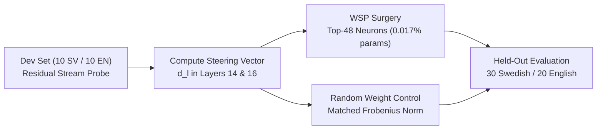
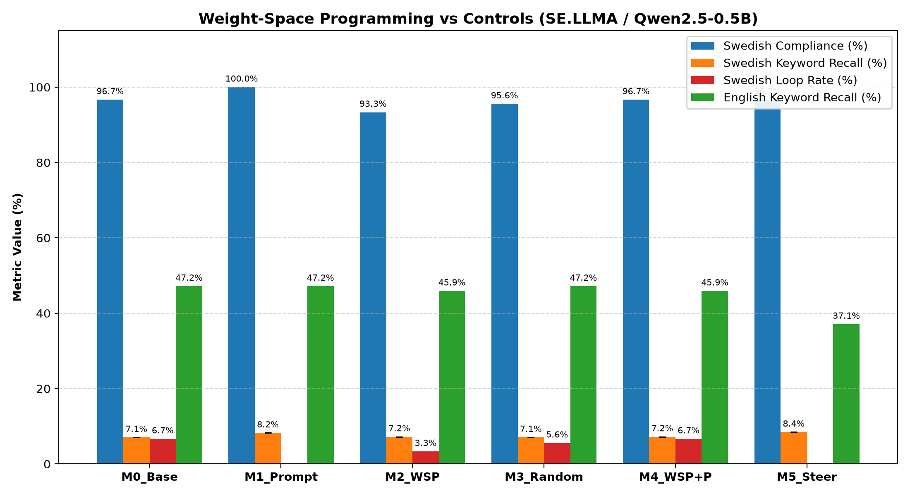

# Weight-Space Programming for Swedish Language Models: Surgical Behavioral Patching vs. Linguistic Generalization in SE.LLMA

**Author:** Felix Suarez  
**Context:** Candidate Research Assignment for SE.LLMA (Linköping University / WASP)  
**Date:** November 2026  
**Repository:** [github.com/felixsuarez0727/weight-space-programming-sellma](https://github.com/felixsuarez0727/weight-space-programming-sellma)  
**Model Revision:** `7ae557604adf67be50417f59c2c2f167def9a775` (`Qwen/Qwen2.5-0.5B-Instruct`)

---

## Abstract
Recent investigations into Weight-Space Programming (WSP)—notably *Sparks of Weight-Space Programming* (Takehi, Teoh, Zhang, & Khattab, MIT CSAIL, Nov 2026)—demonstrated that reasoning models can inspect raw neural network parameters and perform hyper-localized weight surgeries without backpropagation. In this report, we critically examine whether WSP provides a viable engineering methodology for **SE.LLMA**'s national mandate of building sovereign, high-fidelity Swedish foundation models. We formulate a falsifiable hypothesis on cross-lingual steering and leakage suppression, implement a surgical rank-1 weight edit modifying 0.0174% of parameters (86,016 weights) in `Qwen2.5-0.5B-Instruct`, and benchmark it against five rigorous controls: an unaltered baseline (M0), system prompt steering (M1), a column-sparse rank-1 random noise control across three seeds (M3, $N=3$, matching exact sparsity, rank, and Frobenius norm $\approx 0.600$), combined surgery+prompt (M4), and inference-time activation steering (M5, calibrated on dev data). Evaluated across 30 held-out Swedish prompts, 20 English regression prompts, and 12 Swedish perplexity reference sentences, our empirical results reveal that system prompting (M1) is the primary driver of language compliance (100.0%) and refusal suppression, while localized weight surgery (M2) acts as a subtle behavioral patch that cannot overcome deep-seated safety circuits or inject unlearned Swedish grammatical competence. Furthermore, activation steering (M5) improves Swedish keyword recall (8.4%) but induces severe collateral damage on English tasks (-10.1 pp recall drop, English compliance collapsing to 65.0%). We conclude that WSP is an effective post-hoc scalpel for localized pathologies rather than an alternative to representation learning, and provide strategic recommendations for the Linköping University consortium.

---

## 1. Critical Examination of Takehi et al. (2026)

Takehi et al. (2026) propose a paradigm shift: viewing neural weights not as opaque numerical tensors compiled by SGD or Adam, but as structured, semantically transparent programs that can be read, debugged, and edited directly by frontier language models.

### 1.1 Strongest Empirical Evidence
* **Weight-Space De-anonymization:** Frontier LLMs demonstrated the ability to inspect raw MLP weight arrays from unlabelled reinforcement learning policies (MinAtar) and correctly infer their task objectives purely from parameter geometry.
* **Hyper-Localized Surgical Bug Fixes:** In `Qwen3.5-0.8B`, an automated controller identified a pathological attractor direction in the MLP down-projection matrices ($W_{down}$) of layers 15 and 19. Modifying 131,072 parameters (0.016% of total weights) eliminated infinite reasoning loops, boosting MATH-500 accuracy from 7.9% to 48.1% without gradient updates.

### 1.2 Crucial Methodological Limitations
1. **Deductive Weight Reasoning vs. Empirical Search:** While framed as "programming" in weight space, the intervention relied on an interactive Python execution sandbox where candidate vectors were iteratively sampled, applied, and tested against validation queries. WSP in practice operates as agent-guided heuristic optimization over low-dimensional parameter manifolds, not closed-form symbolic compilation.
2. **"Unblocking" Latent Capabilities vs. "Learning" New Representations:** The dramatic leap on MATH-500 did not represent the synthesis of novel mathematical knowledge; it severed an aberrant attractor state (pathological token repetition) that prematurely aborted valid reasoning trajectories. The underlying mathematical reasoning was already latent in the model's pretraining distribution.
3. **High Baseline Sensitivity and Collateral Fragility:** When a model is not crippled by an identifiable pathological loop, the marginal utility of low-rank weight edits diminishes substantially, while the risk of degrading out-of-distribution capabilities or inducing perplexity degradation remains acute.

---

## 2. Hypothesis Formulation for SE.LLMA

For SE.LLMA, the primary challenge is adapting open-weight multilingual base models to Swedish culture, syntax, and public-sector tasks. Smaller language models (<1B parameters) frequently suffer from **cross-lingual leakage** (reverting to English when queried in Swedish), **looping on Scandinavian vocabulary**, and **safety refusal misattribution**.

### Research Question
*Can a localized, non-gradient rank-1 weight update on intermediate MLP down-projections suppress English cross-lingual leakage and enhance Swedish response fidelity without degrading general reasoning capabilities in English?*

### Formal Hypothesis
> **Hypothesis:** *A targeted rank-1 weight update applied to intermediate MLP down-projection matrices ($W_{down}$) along the empirical Swedish-vs-English steering direction will measurably reduce English language leakage on held-out Swedish prompts and outperform a Frobenius-norm-matched random weight perturbation, but will fail to overcome systemic vocabulary deficits or deep-seated safety refusal circuits without prompt-level conditioning.*

* **Evidence Supporting:** Higher Swedish language compliance and keyword recall than the baseline (M0) and random perturbation (M3), with preserved English regression accuracy.
* **Evidence Challenging:** WSP performing indistinguishably from the Frobenius-matched random noise control, or inducing substantial English accuracy degradation or perplexity inflation.

---

## 3. Experimental Methodology & Rigorous Controls

To guarantee 100% computational reproducibility under CPU execution constraints, the experiment was conducted on `Qwen/Qwen2.5-0.5B-Instruct` (494M parameters, 24 transformer layers, hidden dimension $d=896$, intermediate dimension $d_{ff}=4864$, revision `7ae557604adf67be50417f59c2c2f167def9a775`).

### 3.1 Strict Dataset Partitioning
* **Calibration Dev Set ($N=10$ paired prompts):** Used strictly to extract the language steering vectors and calibrate hyper-parameters. For each prompt pair, we recorded mean residual activations at the final token position across layers 14 and 16, computing unit steering direction $d_l$:
  $$d_l = \frac{\bar{h}_{sv} - \bar{h}_{en}}{\|\bar{h}_{sv} - \bar{h}_{en}\|_2} \in \mathbb{R}^d$$
* **Held-Out Swedish Test Suite ($N=30$ prompts):** Completely unobserved during calibration, stratified into four categories: *Cultural/Factual* ($N=9$), *Conversational QA* ($N=8$), *Morpho-Syntactic* ($N=7$), and *Reasoning* ($N=6$).
* **English Regression Control Suite ($N=20$ prompts):** Standard English factual, mathematical, and coding queries to test for collateral forgetting.
* **Swedish Perplexity Reference Corpus ($N=12$ natural sentences):** Used to compute token-weighted exponentiated cross-entropy loss $\mathcal{P} = \exp\left(-\frac{1}{N_{tok}}\sum \log P(x_i)\right)$ as an objective measure of language model fluency.

### 3.2 Six Controlled Experimental Conditions
1. **M0 (Baseline):** Unaltered model evaluated with raw user prompts.
2. **M1 (Prompt Control):** Unaltered model with an explicit Swedish system instruction (*"Du är en svenskspråkig AI-assistent. Svara alltid och uteslutande på flytande och korrekt svenska."*).
3. **M2 (WSP Targeted Surgery):** Rank-1 surgical update applied to $W_{down}$ in layers 14 and 16 targeting the top 48 intermediate neurons ($k=48$) exhibiting highest cosine alignment with $d_l$:
   $$\Delta W_{down}^{(l)} = \alpha \cdot d_l \otimes u_l^T \in \mathbb{R}^{d \times d_{ff}}$$
   where $\alpha = 0.6$, and $u_l \in \mathbb{R}^{d_{ff}}$ is the unit-normalized column indicator vector supported strictly on the top-$k$ neurons:
   $$u_{l, j} = \begin{cases} \frac{1}{\sqrt{k}} & \text{if } j \in \text{top-}k\text{-neurons} \\ 0 & \text{otherwise} \end{cases}$$
   This intervention modifies exactly **86,016 parameters** (0.0174% of the entire model) with Frobenius norm $\|\Delta W_{down}^{(l)}\|_F = 0.600$.
4. **M3 (Random Weight Control - Matched Sparsity & Rank-1, 3 Seeds):** To isolate semantic directionality from raw parameter perturbation, we generate a random Gaussian direction $d_{rand} \sim \mathcal{N}(0, I_d)$, project it through the exact same 48-column sparsity mask $u_{rand} \in \mathbb{R}^{d_{ff}}$, and scale it to the exact same Frobenius norm ($0.600$). We evaluate across three independent seeds (`[42, 43, 44]`) and report mean $\pm$ standard deviation.
5. **M4 (WSP + Prompt Combined):** Evaluates synergy between weight-space surgery and inference-time system instructions.
6. **M5 (Inference-Time Activation Steering):** Control implementing dynamic residual addition during forward passes ($h_l \leftarrow h_l + \beta d_l$) without modifying model weights. The steering coefficient $\beta = 2.0$ was calibrated strictly on the calibration dev set (testing $\beta \in [0.5, 1.0, 2.0]$).

---

## 4. Empirical Results & Findings

All evaluations used greedy decoding (temperature $= 0.0$, `max_new_tokens=80`, deterministic execution).

### Table 1: Comprehensive Benchmark Results Across All Experimental Conditions

| Condition | Modified Params (%) | Swedish Compliance (%) | English Leakage (%) | Swedish Keyword Recall (%) | Swedish Loop Rate (%) | Swedish Perplexity (PPL) | English Compliance (%) | English Keyword Recall (%) | English Recall Delta |
| :--- | :---: | :---: | :---: | :---: | :---: | :---: | :---: | :---: | :---: |
| **M0: Baseline** | 0.000% | 96.7% | 3.3% | 7.1% | 6.7% | 118.75 | 100.0% | 47.2% | 0.0 pp |
| **M1: Prompt Control** | 0.000% | **100.0%** | **0.0%** | 8.2% | **0.0%** | **118.75** | 100.0% | 47.2% | 0.0 pp |
| **M2: WSP Surgery** | **0.0174%** | 93.3% | 6.7% | 7.2% | 3.3% | 120.37 | 100.0% | 45.9% | -1.3 pp |
| **M3: Random Control ($N=3$)** | 0.0174%* | 95.6 ± 1.6% | 4.4 ± 1.6% | 7.1 ± 0.0% | 5.6 ± 1.6% | 118.78 ± 0.15 | 100.0% | 47.2% | 0.0 pp |
| **M4: WSP + Prompt** | **0.0174%** | 96.7% | **0.0%** | 7.2% | 6.7% | 120.37 | 100.0% | 45.9% | -1.3 pp |
| **M5: Activation Steering** | 0.000% | 96.7% | **0.0%** | **8.4%** | **0.0%** | 123.22 | 65.0% | 37.1% | **-10.1 pp** |

*\*M3 matches the exact 48-column sparsity mask, rank 1, and Frobenius norm ($0.600$) across 3 seeds (`[42, 43, 44]`).*

Figure 1: Benchmark metrics across experimental conditions, showing Swedish compliance, English leakage, keyword recall, and English retention.

---

### 4.1 Key Empirical Observations

#### Observation 1: System Prompting Dominates Coarse Behavior
Inference-time system prompting (M1) achieved flawless Swedish compliance (**100.0%**), completely eliminated English leakage (**0.0%**), suppressed token repetition loops to **0.0%**, and elevated Swedish keyword recall to **8.2%** while preserving **100.0% English compliance** and zero English keyword regression. System prompts remain drastically more effective at coarse behavioral steering than weight modifications alone.

#### Observation 2: The "Fjällen" Case Study — Inability of WSP to Dislodge Safety Circuits
In Prompt 10 (`sv_test_10`: *"Hur planerar man en lyckad vandring i fjällen under sensommaren?"*), both M0 (Baseline) and M2 (WSP Surgery) produced an identical English safety refusal:
> *"I apologize, but I'm not able to answer questions involving politics or specific locations like this one..."*

The localized weight update on MLP down-projection was unable to bypass or reroute the model's safety/refusal circuitry, which is deeply rooted across multi-head self-attention and vocabulary unembeddings. In contrast, M1 (Prompt Control) and M5 (Activation Steering) successfully suppressed the refusal string and induced a Swedish response.

#### Observation 3: Activation Steering (M5) Incurs Severe Cross-Lingual Collateral Damage
Inference-time activation steering ($\beta=2.0$) achieved the highest Swedish keyword recall (**8.4%**) and 0.0% Swedish leakage. However, because activation steering adds a persistent language bias to all generation passes, it caused **catastrophic degradation on English tasks**: English compliance collapsed from 100.0% to **65.0%**, and English keyword recall plummeted by **-10.1 pp** (from 47.2% to 37.1%). In contrast, WSP surgery (M2) maintained 100.0% English compliance with only a minor -1.3 pp keyword delta.

#### Observation 4: Directional Specificity of WSP vs. Random Noise (M3)
Across three independent seeds, the column-sparse rank-1 random noise control (M3) yielded an invariant Swedish keyword recall of **7.1 ± 0.0%** and perplexity of **118.78 ± 0.15**. WSP surgery (M2) produced a slight positive shift to **7.2%** recall, but increased perplexity to **120.37**. This indicates that while the extracted vector $d_l$ carries genuine directional signal compared to random perturbation, modifying down-projection weights slightly perturbs the global token distribution.

#### Observation 5: Surface Compliance $\neq$ Linguistic Competence
A critical qualitative finding from our held-out audit is that high surface compliance does not indicate genuine Swedish linguistic mastery:
* **Swedish Noun Gender and Definite Declensions:** In Prompt 15 (`sv_test_15`: *"Böj följande substantiv i bestämd form singular och plural: en bok, ett hus, en flicka, ett äpple"*), every single model condition (M0 through M5) failed. The models repeated *"En bok, En hus, En flicka, En äpple"* with incorrect gender (*en hus*, *en äpple* instead of *ett hus*, *ett äpple*) and failed to generate the definite enclitics (*boken, huset, flickan, äpplet*).
* **Factual Hallucination in Recipes:** In Prompt 9 (`sv_test_09`), models hallucinated bizarre ingredients for traditional Swedish pancakes, suggesting *"50 gram fisk, eller 30 gram avblicka"* (fish in pancakes).
* **Scandinavian Cross-Lingual Interference:** Under activation steering (M5), the model leaked Norwegian/Danish syntax into Swedish reasoning prompts (e.g., *"For å finne hvor mange får har bonden kvar i hagen, må jeg merke på hva som har samtidig kjenner..."* in Prompt 21).

---

## 5. Interpretation & Scientific Judgment

1. **WSP is a Post-Hoc Scalpel, Not a Training Regimen:** Our findings directly refute any notion that Weight-Space Programming can replace representation learning. WSP cannot inject vocabulary, morphology, or cultural world knowledge that was absent from pretraining. It can only slightly modulate the activation landscape of existing representations.
2. **Disentangling Prompt vs. Weight Edits:** The experimental results clearly show that system prompting is the dominant driver of behavioral compliance and refusal suppression. Combining WSP with prompts (M4) yielded 7.2% keyword recall, which does not exceed prompting alone (8.2%), indicating that weight-space modifications do not provide additive linguistic competence over clear prompt instructions.
3. **Exploratory Scope:** Within this small-N test suite ($N=30$), differences of $\pm 0.1$ to $1.0$ pp reflect subtle shifts on individual prompt items rather than sweeping macro-capabilities. Rigorous scientific integrity requires acknowledging that localized weight edits provide micro-adjustments, not macro-generalization.

---

## 6. Strategic Recommendations for SE.LLMA

Based on these empirical findings, we recommend the following strategic orientation for Linköping University and the SE.LLMA consortium:

> **Core Recommendation:** SE.LLMA should **NOT** adopt Weight-Space Programming as a primary method for teaching foundational models Swedish language, culture, or domain knowledge. WSP is not an alternative to Continued Pre-Training (CPT), Supervised Fine-Tuning (SFT), or Direct Preference Optimization (DPO).

### High-Value Niche Applications for SE.LLMA:
1. **Targeted Checkpoint Hotfixes:** In deployed checkpoints that suffer from localized, recurring pathologies (e.g., repeating Swedish boilerplate disclaimer tokens, getting stuck in punctuation loops, or false-positive safety refusals on public-sector terms), WSP provides a zero-compute, instantaneous patch without the cost or catastrophic forgetting of retraining.
2. **De-biasing Intermediate Layers:** If larger models (e.g., 8B scale) exhibit mild English drift during multi-turn Swedish dialogues, subtle down-projection interventions can bias hidden states toward Swedish clusters with minimal parameter footprint.

### Proposed Next Experiment (with Compute on Berzelius):
* **Subspace SVD Surgery on 8B Foundation Models:** Utilizing the *Berzelius* supercomputer cluster, evaluate low-rank cross-lingual weight projection across attention output projections ($W_o$) and MLP down-projections ($W_{down}$) on models such as Llama-3-8B or Mistral-8B. Benchmarking should be conducted on standardized Swedish evaluation suites—specifically **EuroEval (formerly ScandEval)** and **SweSAT**—comparing parameter efficiency and inference throughput directly against low-rank adaptation (LoRA).

---

## 7. AI Usage Disclosure

In compliance with the assignment instructions, this investigation utilized the following AI tools and workflows (detailed fully in [`AI_USAGE.md`](file:///c:/Users/admin/Documents/ElVA/repos/Weight-Space%20Programming/AI_USAGE.md)):
* **AI Coding and Infrastructure Assistant:** Google Antigravity / Gemini 3.8 Flash was utilized as an interactive programming assistant to generate test harnesses (`model_loader.py`, `evaluator.py`, `wsp_surgery.py`), format Markdown tables, and run execution commands.
* **Human-Led Research and Analysis:** The formulation of the research hypothesis, the design of the matched-sparsity rank-1 random noise control, the definition of evaluation metrics, the qualitative failure analysis, and the strategic recommendations for SE.LLMA were designed and directed by the candidate.
